# 🏛️ Compendio Maestro 360° de Agent Skills — De la Idea e Investigación hasta la Aplicación, Hardware, Software Médico, Dental, IIoT, Cloud, Redes Sociales y Operación Autónoma 24/7

[](./LICENSE)
[-10B981.svg)](https://agentskills.io)
[](#📖-catálogo-maestro-explicado-por-fase-del-ciclo-de-vida)

> **Estándar Abierto `SKILL.md` (`agentskills.io`)** · **63 Skills de Nivel Principal / Staff Engineer** · **Licencia: [GNU General Public License v3.0 (GPL-3.0)](./LICENSE)** · Compatible con **Google Antigravity**, **Claude Code**, **Cursor**, **GitHub Copilot Agent**, **Windsurf** y **OpenAI Codex**.

Este repositorio es un **compendio integral y autocontenido de 63 Agent Skills** diseñado para cubrir **el 100% del ciclo de vida de un producto tecnológico, industrial, médico y de negocio**: desde la chispa de la idea inicial, la investigación profunda y el diseño de arquitectura, pasando por el desarrollo Web, Móvil, Escritorio, **Hardware Periférico (Lectores de Códigos de Barras, Lectores/Generadores QR, Impresoras Térmicas ESC/POS, Balanzas)**, **Software Médico Hospitalario (HL7 v2.x, FHIR R4/R5, DICOM/PACS, HIPAA)**, **Software Dental y Clínico (Odontograma SVG FDI/Universal/Palmer, Periodontograma, TWAIN/Rayos X)**, **Automatización Industrial IIoT/SCADA (OPC UA, Modbus TCP/RTU, PLCs, MQTT Sparkplug B)**, Edge/Serverless, Ingeniería de Datos, ERP/Contabilidad, E-Commerce, Pagos e Inteligencia Artificial (RAG, MCP, Clonación de Voz, Traducción Automática e i18n), hasta las pruebas empíricas de QA/TDD, depuración científica de causa raíz, ciberseguridad Zero-Trust, automatización ofimática (PDF/DOCX/XLSX/PPTX), videos demostrativos, despliegue en la nube, campañas publicitarias, **CRO/Analítica**, **automatización de redes sociales**, **Service Desk ITIL v4** y **operación autónoma 24/7 con auto-recuperación**.

Sintetiza estándares de ingeniería probados en producción junto con los patrones de los repositorios y organizaciones más influyentes del ecosistema global (**`anthropics/skills`**, **`obra/superpowers`**, **`vercel-labs/agent-skills`**, **`supabase/agent-skills`**, **`cloudflare/skills`**, **`coreyhaines31/marketingskills`**, **HL7 International**, **DICOM Standard**, **ADA**, **OPC Foundation**, **Modbus Organization**, **`NVIDIA/NeMo-Guardrails`**, **`rwspatin/bpmn-skill`**, **DDD**, **OWASP ASVS v4**, **ISO/IEC 27001/42001/9001/22301**, **NIIF/IFRS** y **C4 Model**).

---

## 🧭 Mapa del Ciclo de Vida Completo 360° (Las 9 Fases y sus 63 Skills)

```mermaid
flowchart TB
    classDef truth fill:#831843,stroke:#EC4899,stroke-width:2px,color:#F8FAFC
    classDef discovery fill:#0C4A6E,stroke:#38BDF8,stroke-width:2px,color:#F8FAFC
    classDef arch fill:#78350F,stroke:#F59E0B,stroke-width:2px,color:#F8FAFC
    classDef build fill:#064E3B,stroke:#10B981,stroke-width:2px,color:#F8FAFC
    classDef domain fill:#1E3A8A,stroke:#60A5FA,stroke-width:2px,color:#F8FAFC
    classDef qa fill:#14532D,stroke:#4ADE80,stroke-width:2px,color:#F8FAFC
    classDef docs fill:#3B0764,stroke:#C084FC,stroke-width:2px,color:#F8FAFC
    classDef ops fill:#312E81,stroke:#818CF8,stroke-width:2px,color:#F8FAFC
    classDef growth fill:#7C2D12,stroke:#FB923C,stroke-width:2px,color:#F8FAFC

    subgraph F0 ["Fase 0: Mantenimiento de la Verdad, Gobernanza Autónoma y Meta-Skills (5)"]
        S01["01. anti-sycophancy-direct-truth"]:::truth
        S02["02. integrity-governance-guard"]:::truth
        S03["03. autonomous-token-frugal-governance"]:::truth
        S04["04. skill-creator-installer"]:::truth
        S05["05. skills-curator-evaluator"]:::truth
    end

    subgraph F1 ["Fase 1: Ideación, Investigación Profunda, Estrategia de Producto, Finanzas y Legal (5)"]
        S06["06. deep-search-research-lead"]:::discovery
        S07["07. product-discovery-saas-strategy"]:::discovery
        S08["08. financial-fpa-roi-architect"]:::discovery
        S09["09. compliance-regulatory-auditor"]:::discovery
        S10["10. data-privacy-legal-dpo"]:::discovery
    end

    subgraph F2 ["Fase 2: Arquitectura de Software, Bases de Datos, ETL/BI y Motores BPM (6)"]
        S11["11. backend-ddd-clean-architect"]:::arch
        S12["12. database-postgresql-architect"]:::arch
        S13["13. data-engineering-etl-bi-architect"]:::arch
        S14["14. api-contract-gateway-governance"]:::arch
        S15["15. bpm-workflow-saga-architect"]:::arch
        S16["16. software-architecture-diagrammer"]:::arch
    end

    subgraph F3 ["Fase 3: Creación Web, App Móvil, Desktop, Hardware, IA, MCP y Voz (14)"]
        S17["17. ui-ux-design-system-architect"]:::build
        S18["18. landing-page-design"]:::build
        S19["19. webmaster-seo-landing-conversion"]:::build
        S20["20. mobile-cross-platform-architect"]:::build
        S21["21. cross-platform-desktop-packager"]:::build
        S22["22. barcode-qr-thermal-hardware-bridge"]:::build
        S23["23. ai-llm-rag-agentic-architect"]:::build
        S24["24. mcp-server-builder-architect"]:::build
        S25["25. realtime-ai-streaming-lead"]:::build
        S26["26. speech-to-speech-audio-architect"]:::build
        S27["27. voice-cloning-acoustic-adaptation"]:::build
        S28["28. machine-translation-localization-i18n"]:::build
        S29["29. windows-audio-native-architect"]:::build
        S30["30. linux-audio-native-architect"]:::build
    end

    subgraph F4 ["Fase 4: Verticales Especializadas: Salud/Médico, Dental, IIoT Industrial, ERP, E-Commerce, Fintech y Logística (11)"]
        S31["31. healthcare-hl7-fhir-medical-systems"]:::domain
        S32["32. dental-odontogram-imaging-systems"]:::domain
        S33["33. industrial-iiot-scada-plc-architect"]:::domain
        S34["34. erp-accounting-payroll-architect"]:::domain
        S35["35. ecommerce-catalog-checkout-architect"]:::domain
        S36["36. fintech-payments-billing-architect"]:::domain
        S37["37. logistics-distribution-systems"]:::domain
        S38["38. fleet-telematics-iot-audit"]:::domain
        S39["39. cctv-physical-security-audit"]:::domain
        S40["40. it-governance-forensic-audit"]:::domain
        S41["41. executive-board-reporting"]:::domain
    end

    subgraph F5 ["Fase 5: Calidad Empírica (QA), TDD, Depuración Científica, Ciberseguridad y Auto-Curación SRE (6)"]
        S42["42. qa-evidence-based-verification"]:::qa
        S43["43. tdd-red-green-refactor"]:::qa
        S44["44. systematic-debugging-root-cause"]:::qa
        S45["45. e2e-webapp-load-testing-lead"]:::qa
        S46["46. cybersecurity-zero-trust-defensive"]:::qa
        S47["47. observability-sre-self-healing"]:::qa
    end

    subgraph F6 ["Fase 6: Documentación Viva (Docs-as-Code), Suite Ofimática, Procesos de Negocio y Videos Demo (4)"]
        S48["48. technical-documentation-process-governance"]:::docs
        S49["49. process-flow-documentation"]:::docs
        S50["50. office-document-automation-suite"]:::docs
        S51["51. automated-demo-video-training-producer"]:::docs
    end

    subgraph F7 ["Fase 7: Publicación Cloud, Edge/Serverless, Git Worktrees y Mantenimiento Evolutivo (4)"]
        S52["52. devops-immutable-cloud-infrastructure"]:::ops
        S53["53. edge-serverless-cdn-architect"]:::ops
        S54["54. git-worktree-release-engineering"]:::ops
        S55["55. code-simplifier-refactoring-maintenance"]:::ops
    end

    subgraph F8 ["Fase 8 & 9: Publicidad, CRO, Redes Sociales, Soporte ITIL, Cron/Swarm y Talento (8)"]
        S56["56. advertising-marketing-lead"]:::growth
        S57["57. cro-analytics-growth-experiments"]:::growth
        S58["58. social-media-omnichannel-automation"]:::growth
        S59["59. customer-success-support-automation"]:::growth
        S60["60. autonomous-workflow-cron-swarm"]:::growth
        S61["61. job-hunter-scout"]:::growth
        S62["62. resume-ats-optimizer"]:::growth
        S63["63. linkedin-profile-optimizer"]:::growth
    end

    F0 --> F1 --> F2 --> F3 --> F4 --> F5 --> F6 --> F7 --> F8
```



---

## 📂 Árbol Completo de Archivos del Repositorio (63 Skills)

Cada skill cuenta con su propio archivo canónico `SKILL.md` listo para ser descubierto por cualquier agente compatible:

```text
AI-SIASANI-Skills/
├── LICENSE
├── README.md
└── skills/
    ├── advertising-marketing-lead/SKILL.md
    ├── ai-llm-rag-agentic-architect/SKILL.md
    ├── anti-sycophancy-direct-truth/SKILL.md
    ├── api-contract-gateway-governance/SKILL.md
    ├── automated-demo-video-training-producer/SKILL.md
    ├── autonomous-token-frugal-governance/SKILL.md
    ├── autonomous-workflow-cron-swarm/SKILL.md
    ├── backend-ddd-clean-architect/SKILL.md
    ├── barcode-qr-thermal-hardware-bridge/SKILL.md
    ├── bpm-workflow-saga-architect/SKILL.md
    ├── cctv-physical-security-audit/SKILL.md
    ├── code-simplifier-refactoring-maintenance/SKILL.md
    ├── compliance-regulatory-auditor/SKILL.md
    ├── cro-analytics-growth-experiments/SKILL.md
    ├── cross-platform-desktop-packager/SKILL.md
    ├── customer-success-support-automation/SKILL.md
    ├── cybersecurity-zero-trust-defensive/SKILL.md
    ├── data-engineering-etl-bi-architect/SKILL.md
    ├── data-privacy-legal-dpo/SKILL.md
    ├── database-postgresql-architect/SKILL.md
    ├── deep-search-research-lead/SKILL.md
    ├── dental-odontogram-imaging-systems/SKILL.md
    ├── devops-immutable-cloud-infrastructure/SKILL.md
    ├── e2e-webapp-load-testing-lead/SKILL.md
    ├── ecommerce-catalog-checkout-architect/SKILL.md
    ├── edge-serverless-cdn-architect/SKILL.md
    ├── erp-accounting-payroll-architect/SKILL.md
    ├── executive-board-reporting/SKILL.md
    ├── financial-fpa-roi-architect/SKILL.md
    ├── fintech-payments-billing-architect/SKILL.md
    ├── fleet-telematics-iot-audit/SKILL.md
    ├── git-worktree-release-engineering/SKILL.md
    ├── healthcare-hl7-fhir-medical-systems/SKILL.md
    ├── industrial-iiot-scada-plc-architect/SKILL.md
    ├── integrity-governance-guard/SKILL.md
    ├── it-governance-forensic-audit/SKILL.md
    ├── job-hunter-scout/SKILL.md
    ├── landing-page-design/SKILL.md
    ├── linkedin-profile-optimizer/SKILL.md
    ├── linux-audio-native-architect/SKILL.md
    ├── logistics-distribution-systems/SKILL.md
    ├── machine-translation-localization-i18n/SKILL.md
    ├── mcp-server-builder-architect/SKILL.md
    ├── mobile-cross-platform-architect/SKILL.md
    ├── observability-sre-self-healing/SKILL.md
    ├── office-document-automation-suite/SKILL.md
    ├── process-flow-documentation/SKILL.md
    ├── product-discovery-saas-strategy/SKILL.md
    ├── qa-evidence-based-verification/SKILL.md
    ├── realtime-ai-streaming-lead/SKILL.md
    ├── resume-ats-optimizer/SKILL.md
    ├── skill-creator-installer/SKILL.md
    ├── skills-curator-evaluator/SKILL.md
    ├── social-media-omnichannel-automation/SKILL.md
    ├── software-architecture-diagrammer/SKILL.md
    ├── speech-to-speech-audio-architect/SKILL.md
    ├── systematic-debugging-root-cause/SKILL.md
    ├── tdd-red-green-refactor/SKILL.md
    ├── technical-documentation-process-governance/SKILL.md
    ├── ui-ux-design-system-architect/SKILL.md
    ├── voice-cloning-acoustic-adaptation/SKILL.md
    ├── webmaster-seo-landing-conversion/SKILL.md
    └── windows-audio-native-architect/SKILL.md
```

---

## 📖 Catálogo Maestro Explicado por Fase del Ciclo de Vida

### Fase 0: Mantenimiento de la Verdad, Gobernanza Autónoma y Meta-Skills (5)

| # | Skill | Archivo | Propósito y Estándares Clave |
| :-: | :--- | :--- | :--- |
| **01** | **Anti-Sycophancy & Direct Technical Truth** | [SKILL.md](./skills/anti-sycophancy-direct-truth/SKILL.md) | **Elimina la adulación y complacencia.** Fuerza análisis *Red-Team / Pre-Mortem* (¿dónde fallará en producción?), separa hechos verificados de hipótesis e impide ceder ante anti-patrones por presión del usuario. |
| **02** | **Integrity & Governance Guard** | [SKILL.md](./skills/integrity-governance-guard/SKILL.md) | **Veedor de veracidad empírica (*Fail-Closed HITL*).** Inspirado en *Constitutional AI* y *NeMo Guardrails*. Prohíbe inventar pruebas o usar parches efímeros, exige backups físicos pre-mutación y solicita confirmación humana ante órdenes ambiguas o destructivas. |
| **03** | **Autonomous Execution, Token-Frugal Context & Safety Stop Governance** | [SKILL.md](./skills/autonomous-token-frugal-governance/SKILL.md) | **Gobernanza autónoma acotada (*Bounded Assume YES*) y ahorro extremo de tokens.** Ejecución 100% autónoma en desarrollo, parada de seguridad obligatoria (*HITL*) en mutaciones de bases de datos o comandos destructivos, modo diagnóstico de solo lectura y lecturas quirúrgicas. |
| **04** | **Skill Creator & Installer** | [SKILL.md](./skills/skill-creator-installer/SKILL.md) | **Meta-skill para diseñar e instalar nuevas skills.** Basado en `anthropics/skills/skill-creator`. Define los 3 niveles de *Progressive Disclosure*, la anatomía de 5 bloques, descripciones *anti-undertriggering* y auditoría de seguridad para importar skills de GitHub. |
| **05** | **Skills Curator & Lifecycle Evaluator** | [SKILL.md](./skills/skills-curator-evaluator/SKILL.md) | **Curaduría continua y sincronización *Anti-Drift*.** Audita compuertas deterministas (*Tool-Gates*), frugalidad de tokens y detecta desfases de versión (SHA-256) entre múltiples repositorios. |

---

### Fase 1: Ideación, Investigación Profunda, Estrategia de Producto, Finanzas y Legal (5)

| # | Skill | Archivo | Propósito y Estándares Clave |
| :-: | :--- | :--- | :--- |
| **06** | **Deep Search & Research Lead** | [SKILL.md](./skills/deep-search-research-lead/SKILL.md) | **Investigación profunda multi-hop y búsqueda forense.** Descomposición en 3–5 sub-preguntas ortogonales, rastreo quirúrgico de código sin ruido, *dorking* de RFCs/CVEs/normativas y benchmarking competitivo global. |
| **07** | **Product Discovery & SaaS Strategy Lead** | [SKILL.md](./skills/product-discovery-saas-strategy/SKILL.md) | **De la idea al PRD ejecutable.** Validación de problema (*JTBD*), evaluación *Greenfield vs. Brownfield*, priorización matemática **RICE**, arquitectura de *Feature Flags* y *Self-Service Onboarding* (`Time-to-Value < 5 min`). |
| **08** | **Financial FP&A, Accounting & FinOps Architect** | [SKILL.md](./skills/financial-fpa-roi-architect/SKILL.md) | **Ingeniería financiera, NIIF/IFRS y métricas de negocio.** Prohibición de `float`/`double` para dinero, invariante de partida doble ($\sum \text{Debe} = \sum \text{Haber}$), ratios financieros (Liquidez, EBITDA, ROE DuPont), métricas SaaS (ARR, NRR, LTV/CAC), consolidación Holding (NIIF 10) y FinOps cloud. |
| **09** | **Compliance & Regulatory Auditor** | [SKILL.md](./skills/compliance-regulatory-auditor/SKILL.md) | **Cumplimiento normativo *Compliance-by-Design*.** Controles técnicos para ISO 27001/27701/42001, SOC 2, PCI-DSS v4.0, GDPR, EU AI Act, SOX 404 (4 ojos), NIIF/IFRS y marcos tributarios/laborales de Norteamérica, Centroamérica y Europa. |
| **10** | **Data Privacy Officer (DPO) & IT Legal Lead** | [SKILL.md](./skills/data-privacy-legal-dpo/SKILL.md) | **Privacidad, contratos legales SaaS y evidencia digital.** Consentimiento inmutable, derechos ARCO/portabilidad/olvido con preservación fiscal, cuarteto contractual (ToS, SLA, DPA, Privacidad), legalidad GPS/CCTV laboral y cadena de custodia ISO/IEC 27037. |

---

### Fase 2: Arquitectura de Software, Bases de Datos, ETL/BI y Motores BPM (6)

| # | Skill | Archivo | Propósito y Estándares Clave |
| :-: | :--- | :--- | :--- |
| **11** | **Backend DDD & Clean Architecture Lead** | [SKILL.md](./skills/backend-ddd-clean-architect/SKILL.md) | **Dominio soberano y sistemas distribuidos resilientes.** *Domain-Driven Design* (invariantes puros, cero estado en memoria), aislamiento multi-tenant (`HasQueryFilter`), cuarteto de auditoría, patrón **Transactional Outbox** (*Anti-Dual-Write*) y errores **IETF RFC 7807 (`ProblemDetails`)**. |
| **12** | **PostgreSQL Database & Data Architect** | [SKILL.md](./skills/database-postgresql-architect/SKILL.md) | **Persistencia relacional de alto rendimiento y Zero-Downtime DDL.** Esquemas por *Bounded Context*, scripts SQL idempotentes, índices compuestos multi-tenant, migraciones sin bloqueo (`CREATE INDEX CONCURRENTLY`, *Expand-and-Contract*) y particionamiento declarativo temporal. |
| **13** | **Data Engineering, ETL/ELT, Lakehouse & BI Analytics Architect** | [SKILL.md](./skills/data-engineering-etl-bi-architect/SKILL.md) | **Ingeniería de Datos y Arquitectura Medallion (Bronze/Silver/Gold).** Pipelines ETL/ELT idempotentes (*Backfill-Safe*), modelado dimensional Kimball (*Star Schema* y SCD Tipo 2), procesamiento vectorizado de alto rendimiento (DuckDB/Polars) y tableros BI con reconciliación matemática 100% auditable. |
| **14** | **API Contract & Gateway Governance Lead** | [SKILL.md](./skills/api-contract-gateway-governance/SKILL.md) | **Gobernanza de contratos REST/GraphQL e idempotencia.** Evolución aditiva sin rotura, paginación canónica, cabecera `Idempotency-Key` contra pagos/registros duplicados, saneamiento en API Gateway y detección de endpoints huérfanos. |
| **15** | **BPM Workflow, Decision Engine & Saga Architect** | [SKILL.md](./skills/bpm-workflow-saga-architect/SKILL.md) | **Motores de procesos BPMN 2.0, DMN y Sagas distribuidas.** Versionado inmutable de procesos, Segregación de Funciones de 4 ojos (*SoD*) forzada en backend, Sagas con compensación semántica, temporizadores SLA y nodos de IA con umbral *HITL*. |
| **16** | **Software Architecture & Visual Modeler** | [SKILL.md](./skills/software-architecture-diagrammer/SKILL.md) | **Modelado visual formal ISO/IEC/IEEE 42010.** Paleta semántica por capas y plantillas Mermaid para **C4 Model** (Contenedores), **IDEF0** (ICOM), **ERD Crow's Foot**, **UML Secuencia/Estados** y **DFD**. |

---

### Fase 3: Creación Web, App Móvil, Desktop, Hardware, IA, MCP y Voz (14)

| # | Skill | Archivo | Propósito y Estándares Clave |
| :-: | :--- | :--- | :--- |
| **17** | **UI/UX & Enterprise Design System Architect** | [SKILL.md](./skills/ui-ux-design-system-architect/SKILL.md) | **Sistemas de diseño ejecutivos, accesibilidad e i18n.** Tokens semánticos CSS (Dark/Light), los **5 estados obligatorios de toda vista** (*Loading, Empty, Ideal, Mutating, Error*), accesibilidad WCAG 2.2 AA, prohibición de `alert()`/`confirm()` y cero textos quemados. |
| **18** | **High-Impact Landing Page Design Lead** | [SKILL.md](./skills/landing-page-design/SKILL.md) | **Diseño visual de páginas de producto de alto impacto.** Estructuras *Bento Grid* asimétricas, sistema tipográfico `Outfit` + `Inter`, contraste accesible y ergonomía multi-zoom (`100%` a `200%`) sin desbordamientos. |
| **19** | **Webmaster, Technical SEO & Conversion Architect** | [SKILL.md](./skills/webmaster-seo-landing-conversion/SKILL.md) | **Arquitectura web pública, SEO técnico y conversión (CRO).** Estructura de 7 secciones de persuasión, Core Web Vitals (`LCP < 1.8s`, `CLS = 0`), metadatos OpenGraph, JSON-LD `Schema.org`, `sitemap.xml` y formularios asíncronos + WhatsApp directo. |
| **20** | **Mobile Cross-Platform & Offline-First Architect** | [SKILL.md](./skills/mobile-cross-platform-architect/SKILL.md) | **Desarrollo de apps móviles iOS y Android (React Native / Flutter).** Sincronización *Offline-First* con base local SQLite y cola de mutaciones idempotente, almacenamiento en Keychain/Keystore (OWASP MASVS), biometría, notificaciones Push y reglas de aprobación en App Store y Google Play. |
| **21** | **Cross-Platform Desktop Packaging Architect** | [SKILL.md](./skills/cross-platform-desktop-packager/SKILL.md) | **Empaquetado nativo de escritorio (Tauri 2.0 / Electron / Rust).** Generación determinista de instaladores para Windows (`.exe` NSIS / `.msi` WiX), Linux (`.deb` / `.AppImage`) y macOS (`.dmg`) con bajo consumo de RAM y verificación SHA-256. |
| **22** | **Barcode, QR, Thermal Printer & Hardware Peripherals Bridge Lead** | [SKILL.md](./skills/barcode-qr-thermal-hardware-bridge/SKILL.md) | **Integración de hardware periférico comercial e industrial.** Lectores de código de barras 1D/2D por WebHID/WebSerial (sin pérdida de foco de teclado), generadores/decodificadores de códigos QR vectoriales y de cámara, impresoras térmicas ESC/POS (tickets y cajón de dinero) y etiquetas industriales ZPL/TSPL. |
| **23** | **AI, Hybrid RAG, MCP & Agentic Systems Architect** | [SKILL.md](./skills/ai-llm-rag-agentic-architect/SKILL.md) | **Ingeniería de IA en producción.** RAG híbrido aislado por inquilino (`pgvector` + búsqueda léxica BM25 + *Cross-Encoder Reranker*), salidas estructuradas JSON Schema y defensa contra *Indirect Prompt Injection*. |
| **24** | **Model Context Protocol (MCP) Server Builder & Architect** | [SKILL.md](./skills/mcp-server-builder-architect/SKILL.md) | **Servidores Model Context Protocol (MCP) de grado empresarial.** Basado en `modelcontextprotocol.io`. Diseño ergonómico de Tools/Resources/Prompts, transportes `stdio` (con aislamiento estricto de `stderr`) y `Streamable HTTP/SSE` con OAuth2 y validación vía MCP Inspector. |
| **25** | **Real-Time AI Streaming & Multi-Model Router** | [SKILL.md](./skills/realtime-ai-streaming-lead/SKILL.md) | **Inferencia en tiempo real (`< 600 ms` E2E) con SSE y WebSockets.** Enrutador multimodelo con fallback automático entre Groq LPU, Gemini Flash/Live, OpenAI y ejecución local offline con Ollama, resguardando API Keys en bóvedas cifradas. |
| **26** | **Speech-to-Speech & Anti-Echo Audio Architect** | [SKILL.md](./skills/speech-to-speech-audio-architect/SKILL.md) | **Traducción y conversación de voz a voz en tiempo real.** Topología de doble vía con aislamiento acústico total (*Zero-Feedback*), cancelación de eco WebRTC AEC3 e inyección hacia micrófonos virtuales para Meet, Zoom y Teams. |
| **27** | **Voice Cloning, Acoustic Embeddings & Real-Time Timbre Adaptation** | [SKILL.md](./skills/voice-cloning-acoustic-adaptation/SKILL.md) | **Clonación vocal acústica dinámica y estudio de calibración en 15 segundos.** Extracción de *speaker embeddings* (d-vectors/ECAPA-TDNN), preservación del contorno prosódico ($F_0$, timbre, respiración), matriz multi-idioma bidireccional y barra flotante discreta (*Stealth Pill Bar*). |
| **28** | **Machine Translation, Localization (l10n) & Enterprise i18n Architect** | [SKILL.md](./skills/machine-translation-localization-i18n/SKILL.md) | **Internacionalización (i18n), localización (l10n) y traducción automática neuronal.** Formato estándar ICU MessageFormat (plurales e interpolación segura), paridad de catálogos en CI/CD, soporte RTL bidireccional, memorias de traducción (TMX) y glosarios protegidos (*Do-Not-Translate*). |
| **29** | **Windows Core Audio & WASAPI Native Architect** | [SKILL.md](./skills/windows-audio-native-architect/SKILL.md) | **Captura acústica nativa en Windows 10/11.** Captura `WASAPI Loopback` sin drivers externos, conversión en memoria a PCM 16 kHz mono, detección de actividad de voz (VAD) y reconexión en caliente ante cambio de auriculares. |
| **30** | **Linux Audio Native Architect (PipeWire / PulseAudio)** | [SKILL.md](./skills/linux-audio-native-architect/SKILL.md) | **Captura acústica nativa en distribuciones Linux.** Conexión sin privilegios `root` a nodos `.monitor` de PipeWire y PulseAudio con resampling de ultra-baja latencia y bajo consumo de CPU. |

---

### Fase 4: Verticales Especializadas: Salud/Médico, Dental, IIoT Industrial, ERP, E-Commerce, Fintech y Logística (11)

| # | Skill | Archivo | Propósito y Estándares Clave |
| :-: | :--- | :--- | :--- |
| **31** | **Healthcare Software, HL7, FHIR & Medical Devices Architect** | [SKILL.md](./skills/healthcare-hl7-fhir-medical-systems/SKILL.md) | **Software hospitalario y expediente clínico electrónico (EHR/HIS).** Interoperabilidad con HL7 v2.x (ADT/ORM/ORU sobre MLLP/TCP), HL7 FHIR (R4/R5 REST JSON), visores de imágenes médicas DICOM / PACS (DICOMweb WADO-RS), receta electrónica y estricta confidencialidad médica HIPAA. |
| **32** | **Dental Software, Interactive Odontogram & Imaging Systems Architect** | [SKILL.md](./skills/dental-odontogram-imaging-systems/SKILL.md) | **Software odontológico, clínicas dentales y periodontograma.** Odontograma vectorial SVG interactivo multi-nomenclatura (FDI ISO 3950, Universal ADA y Palmer), periodontograma clínico con sondeo de 6 puntos, captura de sensores intraorales de rayos X (TWAIN/DICOM) y presupuestos automáticos. |
| **33** | **Industrial Automation, IIoT, SCADA & PLC Connectivity Architect** | [SKILL.md](./skills/industrial-iiot-scada-plc-architect/SKILL.md) | **Automatización industrial, sistemas SCADA, IIoT e integración con PLCs.** Conectividad con controladores de planta vía OPC UA (Client/Server y PubSub con certificados X.509), Modbus TCP/RTU, MQTT Sparkplug B y cálculo de métricas en tiempo real (OEE y mantenimiento predictivo). |
| **34** | **ERP, Double-Entry Accounting Ledger & HCM Payroll Architect** | [SKILL.md](./skills/erp-accounting-payroll-architect/SKILL.md) | **Arquitectura ERP, Partida Doble inmutable y Nómina HCM.** Invariante matemático $\sum \text{Débito} = \sum \text{Crédito} = 0.0000$, reversión estricta por contra-asiento, candado de períodos fiscales NIIF/IFRS y motor de liquidación salarial con árbol de expresiones auditable. |
| **35** | **E-Commerce, Catalog, Inventory & Omnichannel Checkout Architect** | [SKILL.md](./skills/ecommerce-catalog-checkout-architect/SKILL.md) | **Comercio electrónico de alta concurrencia y reserva atómica de inventario.** Catálogos SPU vs. variantes SKU, congelación inmutable de precios en la orden, prevención de sobreventa (*Zero-Overselling*) en Flash Sales y recuperación omnicanal de carritos abandonados. |
| **36** | **Fintech Payments, Subscriptions & Billing Architect** | [SKILL.md](./skills/fintech-payments-billing-architect/SKILL.md) | **Pasarelas de pago, suscripciones recurrentes y libro mayor.** Cumplimiento PCI-DSS SAQ-A (tokenización 3DS2), activación exclusiva por Webhooks firmados con HMAC-SHA256, idempotencia contra doble cobro, *Smart Dunning* y libro mayor *Append-Only*. |
| **37** | **Logistics, WMS & Supply Chain Systems Architect** | [SKILL.md](./skills/logistics-distribution-systems/SKILL.md) | **Almacenes (WMS), inventarios y distribución (TMS).** Reserva atómica contra saldos negativos, Kardex inmutable con costeo NIC 2, rotación por lotes/vencimientos (**FEFO/FIFO**), *Wave Picking* con Handhelds y prueba electrónica de entrega (*ePOD*). |
| **38** | **Fleet Telematics, CAN-Bus & IoT Logistics Architect** | [SKILL.md](./skills/fleet-telematics-iot-audit/SKILL.md) | **Telemetría vehicular GPS, cadena de frío y control de combustible.** Seguridad M2M en APN privado sobre MQTTS, monitoreo inmutable de temperatura en furgones refrigerados, lectura de computadora de a bordo (CAN Bus J1939) y detección de drenaje de combustible. |
| **39** | **Physical Security, CCTV/VMS & Access Control Auditor** | [SKILL.md](./skills/cctv-physical-security-audit/SKILL.md) | **Videovigilancia IP, control biométrico y redes PoE.** Cálculo de retención en arreglos RAID, aislamiento en VLAN CCTV dedicada sin salida a Internet, hardening contra botnets IoT, respaldo eléctrico UPS y cadena de custodia forense con hash SHA-256. |
| **40** | **IT Governance & Forensic Audit Lead** | [SKILL.md](./skills/it-governance-forensic-audit/SKILL.md) | **Auditoría técnica forense en Modo Solo Lectura.** Basado en COBIT 2019, ITIL v4 e ISO 22301 (BCP/DRP). Diagnóstico sin mutar código productivo estructurado en 3 partes obligatorias: *1. ¿Qué pasa?*, *2. ¿Por qué pasa?* y *3. ¿Qué hacer?*. |
| **41** | **Executive Board & C-Level Reporting Lead** | [SKILL.md](./skills/executive-board-reporting/SKILL.md) | **Informes para Junta Directiva, Accionistas y CFO.** Principio de la Pirámide de Minto (*BLUF*), traducción de riesgos técnicos a impacto patrimonial en dólares, mapas de calor de riesgos, análisis CAPEX/OPEX y plan de acción 30/60/90 días. |

---

### Fase 5: Calidad Empírica (QA), TDD, Depuración Científica, Ciberseguridad y Auto-Curación SRE (6)

| # | Skill | Archivo | Propósito y Estándares Clave |
| :-: | :--- | :--- | :--- |
| **42** | **QA Evidence-Based Verification Lead** | [SKILL.md](./skills/qa-evidence-based-verification/SKILL.md) | **Verificación en caliente (*In-Flight QA*) y Tolerancia Cero a Mocks.** Segregación de funciones (quien codifica no auto-aprueba su entrega), prueba en las 4 capas (SQL, HTTP `curl`, UI con recarga `F5` y bitácora de auditoría), prueba de idempotencia y Bloque de Evidencia Cruda. |
| **43** | **Test-Driven Development (TDD: Red-Green-Refactor) Lead** | [SKILL.md](./skills/tdd-red-green-refactor/SKILL.md) | **Disciplina estricta Red-Green-Refactor y pruebas basadas en propiedades.** Prohibición absoluta de código productivo sin test fallido previo, pirámide de alta fidelidad con Testcontainers reales y verificación de valores límite (*Boundary Value Analysis*). |
| **44** | **Systematic Debugging & Root-Cause Triage Lead** | [SKILL.md](./skills/systematic-debugging-root-cause/SKILL.md) | **Metodología científica de depuración en 4 fases.** Reproducción determinista, trazabilidad del flujo de datos hacia atrás, formulación de hipótesis única falsable y corrección en la raíz blindada con tests de regresión (prohíbe parches cosméticos). |
| **45** | **E2E WebApp Automation & Load Testing Lead** | [SKILL.md](./skills/e2e-webapp-load-testing-lead/SKILL.md) | **Suites E2E en navegador real (Playwright) y pruebas de estrés (k6).** Cero `sleep()` arbitrarios, fallo automático ante cualquier `pageerror` de consola o `HTTP 500`, pruebas de concurrencia contra condiciones de carrera y validación de latencia P95/P99. |
| **46** | **Cybersecurity Zero-Trust & Defensive Architect** | [SKILL.md](./skills/cybersecurity-zero-trust-defensive/SKILL.md) | **Seguridad Zero-Trust y OWASP ASVS v4 Nivel 3.** Firma asimétrica RSA-RS256/JWKS, bloqueo de *Algorithm Confusion Attack*, defensa contra *Tenant Leakage* (Anti-IDOR/BOLA), cookies `HttpOnly`, sanitización de PII en logs y *Rate Limiting* por inquilino. |
| **47** | **Observability, SRE & Self-Healing Systems Architect** | [SKILL.md](./skills/observability-sre-self-healing/SKILL.md) | **Operación autónoma 24/7 y auto-recuperación (*Self-Healing*).** Telemetría OpenTelemetry (Las 4 Señales Doradas), auto-reinicio por `healthcheck`, *Circuit Breakers*, rotación automática de logs/disco, renovación desatendida de certificados SSL y alertas de alta señal. |

---

### Fase 6: Documentación Viva (Docs-as-Code), Suite Ofimática, Procesos de Negocio y Videos Demo (4)

| # | Skill | Archivo | Propósito y Estándares Clave |
| :-: | :--- | :--- | :--- |
| **48** | **Technical Documentation & Process Governance Lead** | [SKILL.md](./skills/technical-documentation-process-governance/SKILL.md) | **Gobernanza *Docs-as-Code*, co-autoría técnica y ADRs.** Sincronización obligatoria entre código, catálogo de APIs, diccionario de datos y manuales multilingües, plantillas **ADR** y *Prueba del Lector Frío*. |
| **49** | **Process Flow Governance & Business Modeling Lead** | [SKILL.md](./skills/process-flow-documentation/SKILL.md) | **Modelado formal de procesos (APQC N0–N3 + ISO 9001 §4.4).** Todo formulario o flujo transaccional se documenta con su ficha **SIPOC**, modelo funcional **IDEF0 (ICOM)**, diagrama de carriles Mermaid, tabla técnica paso a paso, matriz **RACI** y máquina de estados. |
| **50** | **Enterprise Office Document Automation Suite (PDF, DOCX, XLSX & PPTX)** | [SKILL.md](./skills/office-document-automation-suite/SKILL.md) | **Ingeniería documental ofimática automatizada y determinista.** Inspirado en `anthropics/skills`. Generación de Excel con fórmulas nativas auditadas y colores de Wall Street, contratos Word con jerarquía canónica, reportes ejecutivos en PDF sin saltos de página partidos y presentaciones PPTX 16:9. |
| **51** | **Automated Demo Video & Training Producer** | [SKILL.md](./skills/automated-demo-video-training-producer/SKILL.md) | **Grabación automatizada de videos demostrativos 1080p (`.mp4`).** Captura la interfaz web real en ejecución con Playwright interactuando paso a paso, sincronizada con locución neural (`edge-tts`) y subtítulos masterizados con FFmpeg (`H.264 yuv420p`). |

---

### Fase 7: Publicación Cloud, Edge/Serverless, Git Worktrees y Mantenimiento Evolutivo (4)

| # | Skill | Archivo | Propósito y Estándares Clave |
| :-: | :--- | :--- | :--- |
| **52** | **DevOps & Immutable Cloud Infrastructure Lead** | [SKILL.md](./skills/devops-immutable-cloud-infrastructure/SKILL.md) | **Orquestación Docker idempotente y despliegues sin caída.** Mapeo seguro de volúmenes (`/var/lib/postgresql/data` y llaves de sesión), resolución DNS dinámica en Nginx (`resolver 127.0.0.11` con variables `$upstream`), protección de certificados Let's Encrypt y *Smoke Tests* bloqueantes. |
| **53** | **Edge Computing, Serverless Workers & CDN Security Architect** | [SKILL.md](./skills/edge-serverless-cdn-architect/SKILL.md) | **Arquitectura Edge-First, Workers y seguridad perimetral.** Inspirado en `cloudflare/skills` y `vercel-labs/agent-skills`. Verificación JWT asimétrica en el borde (< 2 ms), ingeniería de caché RFC 9111 con *Stale-While-Revalidate*, y estado coordinado con Durable Objects. |
| **54** | **Git Worktrees, Semantic Release Engineering & Branch Governance** | [SKILL.md](./skills/git-worktree-release-engineering/SKILL.md) | **Control de versiones avanzado, desarrollo paralelo y lanzamientos semánticos.** Aislamiento de ramas con `git worktree`, Conventional Commits atómicos obligatorios, versionado SemVer automatizado y prohibición absoluta de reescritura destructiva (`push --force`). |
| **55** | **Code Simplifier & Software Maintenance Architect** | [SKILL.md](./skills/code-simplifier-refactoring-maintenance/SKILL.md) | **Mantenimiento evolutivo sin regresión (*Primum Non Nocere*).** Protocolo de refactorización en 4 fases (Caracterización, Intervención Quirúrgica, Verificación y Poda), cláusulas de guarda (*Early Return*), regla de Sandi Metz y purga física de archivos huérfanos (*Zero-Orphan-Files*). |

---

### Fase 8 & 9: Publicidad, CRO, Redes Sociales, Soporte ITIL, Cron/Swarm y Talento (8)

| # | Skill | Archivo | Propósito y Estándares Clave |
| :-: | :--- | :--- | :--- |
| **56** | **Advertising, Copywriting & Multimedia Production Lead** | [SKILL.md](./skills/advertising-marketing-lead/SKILL.md) | **Campañas publicitarias B2B/B2C y producción audiovisual determinista.** Copywriting de respuesta directa (Eugene Schwartz, PAS, AIDA, BAB, protocolo *Anti-AI-Slop*), fidelidad estricta al código y generación automatizada de Flyers (16:9 y 9:16), tarjetas ejecutivas y spots de video con FFmpeg + PIL + locución neural. |
| **57** | **Conversion Rate Optimization (CRO), Product Analytics & Growth Lead** | [SKILL.md](./skills/cro-analytics-growth-experiments/SKILL.md) | **Optimización de Tasa de Conversión y Analítica de Producto.** Taxonomía de eventos de producto (AARRR), auditoría heurística de fricción en embudos de registro/checkout, experimentación A/B con rigor estadístico ($p < 0.05$) y pruebas de usabilidad de 5 segundos. |
| **58** | **Social Media Omnichannel & Growth Automation Lead** | [SKILL.md](./skills/social-media-omnichannel-automation/SKILL.md) | **Automatización integral de Redes Sociales y conversión de leads.** Multiplicación `1 activo ➔ 7 canales` (LinkedIn, Instagram Reels, TikTok, YouTube Shorts, X, Facebook, WhatsApp Business API y Telegram), cola idempotente de publicación vía APIs OAuth2, enlaces UTM y bots de respuesta inmediata (< 30s) hacia el CRM. |
| **59** | **Customer Success, Service Desk ITIL v4 & AI Support Automation** | [SKILL.md](./skills/customer-success-support-automation/SKILL.md) | **Service Desk ITIL v4 y soporte omnicanal inteligente.** Automatización Tier-1 con IA sin alucinaciones anclada en manuales verificados, gestión estricta de SLAs (MTTR, FRT) con pausa auditada, monitoreo de Customer Health Score y prevención proactiva de Churn. |
| **60** | **Autonomous Workflow, Cron & Multi-Agent Swarm Orchestrator** | [SKILL.md](./skills/autonomous-workflow-cron-swarm/SKILL.md) | **Piloto automático 24/7 y coordinación de enjambres multi-agente.** Tareas Cron autocontenidas con zona horaria IANA (`CRON_TZ`), bloqueos contra solapamiento (`flock` / advisory locks), las 5 rutinas autónomas esenciales (salud, backups, conciliación, digest matutino y auditoría) y trabajo en paralelo con subagentes (*Swarm*). |
| **61** | **Job Hunter & B2B Opportunity Scout** | [SKILL.md](./skills/job-hunter-scout/SKILL.md) | **Inteligencia de oportunidades y contratos remotos B2B.** Filtrado de vacantes/pliegos, cálculo ponderado de afinidad técnica (*Fit Score 0–100%*) y redacción de propuestas directas en 3 párrafos orientadas a resultados. |
| **62** | **Resume & ATS Engineering Optimizer** | [SKILL.md](./skills/resume-ats-optimizer/SKILL.md) | **Optimización algorítmica de CV para filtros ATS.** Redacción de logros bajo la **Fórmula Google XYZ** (*Logré X, medido por Y, mediante Z*), estructura lineal limpia para Workday/Greenhouse y exportación PDF verificable. |
| **63** | **LinkedIn Profile & Executive Branding Optimizer** | [SKILL.md](./skills/linkedin-profile-optimizer/SKILL.md) | **Posicionamiento SEO en LinkedIn Recruiter y marca personal.** Ingeniería de titular (`≤ 220 caracteres`), narrativa de autoridad en "Acerca de", asociación de aptitudes verificadas por cargo y portafolio destacado. |

---

---

## 🚀 Cómo Instalar o Usar este Compendio en Cualquier Agente de IA

### Opción 1: Google Antigravity / Gemini CLI / Cursor
Copia la carpeta `skills/` dentro de `.agents/` en tu proyecto (o globalmente en `~/.gemini/antigravity/skills/`):

```bash
mkdir -p /ruta/a/tu-proyecto/.agents/
cp -r skills /ruta/a/tu-proyecto/.agents/
```

### Opción 2: Claude Code
```bash
mkdir -p /ruta/a/tu-proyecto/.claude/
cp -r skills /ruta/a/tu-proyecto/.claude/
```

### Opción 3: GitHub Copilot (VS Code Agent Mode)
```bash
mkdir -p /ruta/a/tu-proyecto/.github/
cp -r skills /ruta/a/tu-proyecto/.github/
```

### Opción 4: Clonar directamente o instalar mediante `skills.sh`
Puedes clonar este repositorio o instalar directamente sus skills mediante el CLI del estándar abierto:
```bash
git clone https://github.com/SIASA-NI/AI-SIASANI-Skills.git
# O mediante skills.sh CLI:
npx skills add SIASA-NI/AI-SIASANI-Skills
```

---

## ⚖️ Licencia — GNU General Public License v3.0 (GPL-3.0)

Este repositorio y todas las **63 Agent Skills** que lo componen se distribuyen bajo los términos de la **[GNU General Public License v3.0 (GPL-3.0)](./LICENSE)**.

### Derechos y Obligaciones Principales (GPL-3.0)
- ✅ **Uso comercial, privado y académico permitido:** Puedes utilizar, ejecutar e integrar estas skills en tus agentes de IA, flujos de ingeniería y proyectos.
- ✅ **Libertad de estudio y modificación:** Puedes adaptar, ampliar y personalizar cualquier archivo `SKILL.md` según las necesidades de tu organización.
- ✅ **Redistribución libre con Copyleft:** Si redistribuyes este compendio o publicas versiones derivadas/modificadas de sus skills, **debes mantener la misma licencia [GNU GPL v3.0](./LICENSE)**, conservar el aviso de autoría original y poner el código fuente/especificaciones a disposición de los receptores bajo las mismas libertades.
- ⚠️ **Sin garantía:** El software y las especificaciones se proporcionan *"tal cual" (AS IS)*, sin garantías implícitas ni explícitas, conforme a las secciones 15 y 16 de la licencia.

📄 Consulta el texto legal íntegro en el archivo **[LICENSE](./LICENSE)**.
