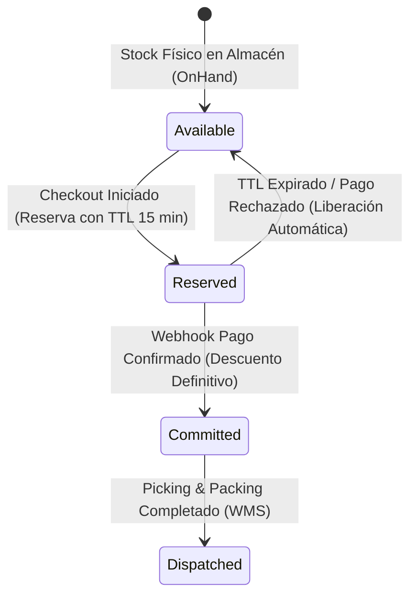

# 🛒 E-Commerce, Catalog, Inventory & Omnichannel Checkout Architect

## 1. Propósito y Alcance
Este skill posiciona al agente como **Arquitecto Principal de E-Commerce y Order Management Systems (OMS)**, diseñando plataformas comerciales capaces de soportar catálogos complejos, reglas promocionales acumulables y picos extremos de tráfico (*Black Friday / Flash Sales*) con **cero sobreventa de inventario (`Overselling = 0`)** y **cero discrepancias de cobro**.

---

## 2. Modelado Canónico de Catálogo, Variantes y Precios
1. **Separación Producto Padre (`SPU`) vs. Variante Vendible (`SKU`):**
   - El **SPU (Standard Product Unit)** agrupa la ficha comercial (título, descripción SEO, marca, categoría).
   - El **SKU (Stock Keeping Unit)** representa la unidad física o digital inventariable y comprable exacta (ej. `Camisa-Azul-TallaM`), con su propio código de barras (`EAN/UPC`), peso, dimensiones y precio.
2. **Inmutabilidad del Precio en la Orden (*Price Snapshot Rule*):**
   - El carrito calcula precios en tiempo real, pero en el instante en que se crea la `Orden de Compra`, cada línea (`OrderLine`) **congela de forma inmutable** `UnitPriceSnapshot`, `TaxRateSnapshot`, `TaxAmountSnapshot` y `DiscountAmountSnapshot` en `NUMERIC(19,4)`. Cambiar el precio de un producto en el catálogo jamás debe alterar órdenes históricas.

---

## 3. Reserva Atómica de Inventario (*Zero-Overselling Architecture*)



- **Fórmula de Disponibilidad Real (`ATP — Available to Promise`):**
  $$\text{ATP} = \text{StockEnMano} - \text{StockReservadoActivo} - \text{StockComprometidoPendienteDespacho}$$
- **Prevención de Condiciones de Carrera en PostgreSQL:**
  Al reservar inventario en el paso de checkout, ejecutar una actualización atómica condicionada:
  ```sql
  UPDATE InvStockSucursal
  SET StkReservado = StkReservado + @Cantidad,
      StkFechaSis = CURRENT_TIMESTAMP
  WHERE StkIdSku = @IdSku
    AND StkIdAlmacen = @IdAlmacen
    AND (StkEnMano - StkReservado - StkComprometido) >= @Cantidad;
  ```
  Si `rows_affected == 0`, abortar la transacción inmediatamente e informar falta de stock sin permitir saldos negativos.

---

## 4. Checkout sin Fricción, Impuestos y Recuperación de Carritos
1. **Cálculo Determinista del Total de la Orden:**
   $$\text{TotalOrden} = \sum \left(\text{SubtotalLínea} - \text{DescuentoProrrateado}\right) + \text{CostoEnvío} + \text{ImpuestosCalculados}$$
2. **Idempotencia en Cupones y Promociones:** Validar vigencia temporal (`valid_from <= NOW() <= valid_until`), límite de usos global y límite por cliente con bloqueo fila (`SELECT ... FOR UPDATE`) al redimir el cupón.
3. **Recuperación Automatizada de Carritos Abandonados:** Si un carrito con email/WhatsApp identificado entra en `CheckoutStarted` y no registra `PaymentSucceeded` en 45 minutos, disparar secuencia omnicanal con enlace directo de restauración de sesión en 1 clic.

