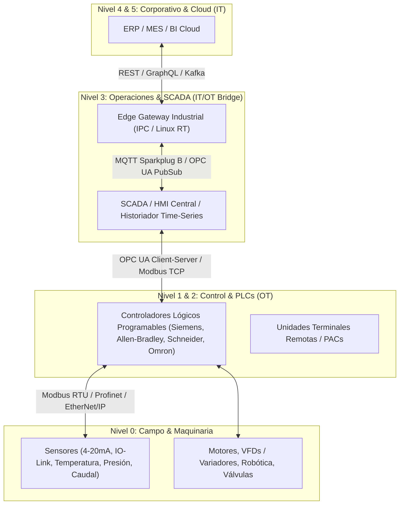

# 🏭 Industrial Automation, IIoT, SCADA & PLC Connectivity Architect

## 1. Propósito y Alcance
Este skill capacita al agente como **Arquitecto Principal de Automatización Industrial, SCADA, Sistemas IIoT y Conectividad con PLCs**, conectando plantas de manufactura, líneas de producción, sensores industriales y maquinaria pesada con plataformas de software modernas, almacenes de series temporales y tableros operativos de planta en tiempo real (*OEE, Mantenimiento Predictivo, Alarmas*).

---

## 2. La Pirámide de Automatización y la Conexión IT/OT

---

## 3. Protocolos de Campo y Conectividad con PLCs

### 3.1. Modbus (Modbus TCP & Modbus RTU RS-485)
- **Modelo de Memoria de 4 Tablas:**
  - `Discrete Inputs` (1 bit, Solo Lectura): Estados de interruptores, finales de carrera.
  - `Coils` (1 bit, Lectura/Escritura): Bobinas, relés, encendido/apagado de actuadores.
  - `Input Registers` (16 bits, Solo Lectura): Lecturas analógicas crudas de sensores (ADC).
  - `Holding Registers` (16 bits, Lectura/Escritura): Parámetros de configuración, consignas (*Setpoints*), variadores de frecuencia.
- **Normalización de Tipos de Datos:** Manejo explícito de orden de bytes (*Endianness*: Big-Endian vs. Little-Endian) al reconstruir flotantes IEEE 754 de 32 bits a partir de dos registros contiguos de 16 bits.

### 3.2. OPC UA (Open Platform Communications Unified Architecture — IEC 62541)
- **Modelo de Información Semántica Orientado a Objetos:**
  - Los datos viajan contextualizados con tipos fuertes, ingeniería de unidades físicas (ej. `°C`, `bar`, `RPM`), marcas de tiempo de fuente (*SourceTimestamp*) y códigos de calidad (*StatusCode: Good, Bad, Uncertain*).
- **Seguridad Criptográfica Nativa (Zero Trust en Planta):**
  - Perfiles de seguridad con intercambio de certificados X.509, cifrado asimétrico y simétrico (`Basic256Sha256`, `Aes128_Sha256_RsaOaep`) y autenticación de usuarios por roles.
- **Suscripciones y Monitoreo por Excepción (*DataChangeNotifications*):**
  - Cero sobrecarga de red por sondeo ciego (*polling*); el servidor OPC UA emite eventos únicamente cuando la variable supera una banda muerta (*deadband*) configurada.

### 3.3. MQTT con Especificación Sparkplug B
- **Infraestructura IIoT Publicador/Suscriptor de Ultra-Bajo Ancho de Banda:**
  - Uso de payloads binarios compactos con Protocol Buffers (Protobuf).
  - Gestión de estado del dispositivo de borde (*Node Death / Birth Certificate — NDEATH / NBIRTH*) para saber en milisegundos si una máquina de planta perdió conectividad.

---

## 4. Cálculo de Métricas Industriales en Tiempo Real (OEE & Mantenimiento Predictivo)
1. **Eficiencia General de los Equipos (OEE — Overall Equipment Effectiveness):**
   $$\text{OEE} = \text{Disponibilidad} \times \text{Rendimiento} \times \text{Calidad}$$
   - **Disponibilidad:** $\frac{\text{Tiempo Operativo Real}}{\text{Tiempo de Producción Planificado}}$ (descontando paradas no programadas).
   - **Rendimiento:** $\frac{\text{Producción Total Real}}{\text{Capacidad Teórica a Velocidad Máxima}}$.
   - **Calidad:** $\frac{\text{Unidades Conformes (Sin Defectos)}}{\text{Total de Unidades Producidas}}$.
2. **Registro en Bases de Datos de Series Temporales (Time-Series):**
   - Ingesta de alta frecuencia (`10 Hz` a `1 kHz`) en PostgreSQL TimescaleDB, InfluxDB o ClickHouse con políticas de retención y compresión columnar automática.
