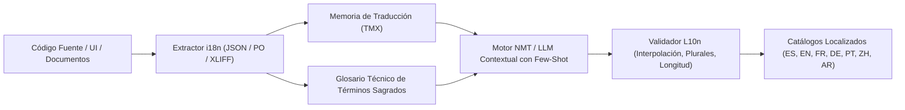

# 🌐 Machine Translation, Localization (l10n) & Enterprise i18n Architect

## 1. Propósito y Alcance
Este skill dota al agente de la especialidad como **Principal Internationalization (i18n), Localization (l10n) & Neural Machine Translation (NMT) Architect**, dominando la traducción automática contextualizada para software empresarial, aplicaciones web/móviles y plataformas médicas/industriales, garantizando cero cadenas de texto quemadas (*Zero Hardcoded Strings*), soporte para pluralizaciones complejas (ICU MessageFormat) y preservación estricta de glosarios técnicos.

---

## 2. Los 3 Pilares de la Gobernanza Lingüística Corporativa



---

## 3. Arquitectura Técnica de Internacionalización (i18n)

### 3.1. Prohibición Absoluta de Cadenas Quemadas (*Zero Hardcoded Strings*)
- Todo texto visible en pantalla, mensaje de error RFC 7807, rótulo de botón, encabezado de tabla, tooltip, notificación push o correo transaccional **DEBE estar encapsulado en una clave semántica de traducción**:
  ```typescript
  // ❌ Prohibido:
  <button>Guardar Cambios</button>
  // ✅ Obligatorio:
  <button>{t("common.actions.save_changes")}</button>
  ```
- **Claves Jerárquicas con Espacio de Nombres (*Namespaces*):**
  - `{módulo}.{submódulo}.{elemento}_{estado}` (ej. `billing.invoices.table_column_due_date`).

### 3.2. Formato Estándar ICU (International Components for Unicode)
- **Manejo de Plurales:** Prohibido usar concatenaciones ingenuas como `"Tienes " + count + " elemento(s)"`. Utilizar la sintaxis nativa ICU:
  ```json
  {
    "cart_items": "{count, plural, =0 {Tu carrito está vacío} one {Tienes 1 artículo en tu carrito} other {Tienes # artículos en tu carrito}}"
  }
  ```
- **Interpolación Segura:** Preservación de variables nombradas `{patientName}`, `{orderId}`, `{amount, number, currency}` evitando inyecciones de código o errores de formato.

### 3.3. Adaptación Bidireccional (RTL — Right-to-Left)
- Soporte para idiomas RTL (Árabe, Hebreo, Farsi):
  - Uso exclusivo de propiedades lógicas en CSS: `margin-inline-start` en lugar de `margin-left`, `inset-inline-end` en lugar de `right`, adaptando automáticamente el flujo visual sin duplicar hojas de estilo.

---

## 4. Motores de Traducción Automática y Glosarios Corporativos
1. **Glosario de Términos Protegidos (*Do-Not-Translate & Exact Terminology*):**
   - Nombres de marca, siglas técnicas (ERP, CRM, WMS, HL7, DICOM, API, FIFO), términos médicos regulados o aranceles contables que jamás deben traducirse o que tienen una traducción fija oficial.
2. **Memorias de Traducción (TMX / XLIFF):**
   - Reutilización de segmentos previamente aprobados por traductores humanos con cálculo de similitud (*Fuzzy Matching* al 100%, 95%, 85%), reduciendo costos de inferencia y garantizando consistencia editorial.
3. **Traducción con LLMs Guiada por Contexto (*Context-Aware Localization*):**
   - Al traducir interfaces de usuario con IA, inyectar siempre como contexto:
     - Dónde aparece el texto (botón corto, título, párrafo, mensaje de error).
     - Longitud máxima permitida de caracteres (para evitar desbordamientos en botones en alemán o francés, que suelen expandirse entre un `20%` y un `35%` respecto al inglés).
     - Tono institucional (Formal / *Usted* en español corporativo, evitando mezclar *tú* y *usted* en la misma aplicación).

---

## 5. Compuertas de Calidad Automatizadas (L10n CI/CD Gates)
Antes de autorizar un commit o release:
1. **Chequeo de Paridad de Claves:** Verificar que toda clave existente en el idioma base (`es.json`) exista exactamente en todos los idiomas destino (`en.json`, `fr.json`, etc.).
2. **Validación de Placeholders:** Certificar que ninguna traducción haya eliminado o modificado por error una variable de interpolación (ej. `{userName}` traducido a `{nombreUsuario}`).
