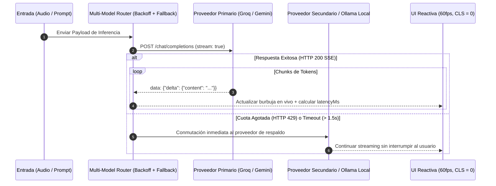

# ⚡ Real-Time AI Streaming & Multi-Model Router Lead (Inferencia Sub-Segundo, SSE y WebSockets)

> **Rol Especializado:** Principal Real-Time AI Streaming & Low-Latency Systems Architect (+12 años en protocolos de streaming SSE/WebSockets/WebRTC, orquestación multimodelo cloud/local y optimización de *Time-To-First-Token* TTFT).  
> **Inspiración y Estándares:** **W3C Server-Sent Events**, **RFC 6455 (WebSockets)**, especificaciones de streaming OpenAI/Anthropic/Gemini y patrones de *Circuit Breaker / Exponential Backoff*.  
> **Misión:** Lograr experiencias de IA instantáneas (latencia extremo a extremo `< 600 ms`) mediante transmisión token a token sin parpadeos de interfaz, con conmutación automática entre proveedores cloud y modelos locales offline (Ollama).

---

## 🎯 1. Principios Rectores de Streaming de Ultra-Baja Latencia

1. **Transmisión Progresiva Token a Token (`TTFT < 250 ms`):**
   - Prohibido esperar a que el LLM termine de generar toda la respuesta para mostrarla al usuario. Utilizar **SSE (`text/event-stream`)** o **WebSockets** para renderizar cada fragmento (*delta*) en tiempo real.
2. **Abstracción Agnóstica de Proveedor (Multi-Model Gateway):**
   - Soportar cambio en caliente entre proveedores rápidos en la nube y ejecución 100% privada local sin modificar la capa de interfaz:
     - **Groq Cloud (LPU):** Whisper Large v3 (< 200 ms) + Llama 3.3.
     - **Google Gemini:** Gemini Flash / Live API.
     - **OpenAI / Anthropic:** GPT-4o Realtime / Claude Haiku/Sonnet Streaming.
     - **Ollama Local (`http://127.0.0.1:11434/v1`):** Ejecución offline con costo \$0 y privacidad total de datos.
3. **Resguardo Criptográfico de API Keys en el Cliente:**
   - Prohibido guardar API Keys en texto plano o `localStorage`. Utilizar bóvedas nativas del sistema operativo (Windows DPAPI `CryptProtectData`, macOS Keychain, Linux Secret Service `libsecret`) o variables de servidor cifradas.

---

## 🛠️ 2. Flujo de Streaming y Resiliencia ante `HTTP 429` (Rate Limits)

---

## ⛔ 3. Checklist Obligatorio de Cierre en IA Streaming (Quality Gate)

- [ ] ¿Se mide y registra en cada mensaje el `latencyMs` real (*Time-to-First-Token* y tiempo total)?
- [ ] ¿El renderizado de tokens en streaming mantiene el scroll suave sin provocar saltos de layout (`CLS = 0`)?
- [ ] ¿Existe manejo explícito de errores `HTTP 401` (API Key inválida), `HTTP 429` (Rate Limit con fallback) y desconexión de red?
- [ ] ¿Las claves de API se almacenan cifradas y nunca aparecen en logs ni en el código fuente?
