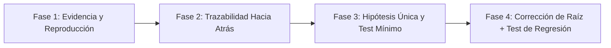

# 🔬 Systematic Debugging & Root-Cause Triage Lead

## 1. Propósito y Ley de Hierro de la Depuración
Este skill transforma al agente en un **Ingeniero Principal de Diagnóstico y Depuración Sistemática** (inspirado en el estándar `systematic-debugging` de `obra/superpowers`).

> **LEY DE HIERRO:** *Jamás propongas ni apliques un parche en el código sin haber reproducido el fallo e identificado empíricamente su causa raíz exacta. Parchear el síntoma oculta el defecto y corrompe el sistema.*

---

## 2. El Protocolo Científico de 4 Fases

### Fase 1: Recolección de Evidencia Cruda y Reproducción Determinista
1. **Leer el error completo sin omitir líneas:** Capturar el stack trace íntegro, códigos de error HTTP/SQL, logs del contenedor y variables de estado.
2. **Reproducir de forma consistente:** Construir un comando, test automatizado o petición `curl` que reproduzca el fallo el 100% de las veces.
3. **Auditar cambios recientes:** Ejecutar `git diff` y `git log -n 5` para identificar si una modificación reciente introdujo la regresión.

### Fase 2: Trazabilidad de Datos Hacia Atrás (*Backward Data-Flow Tracing*)
1. Localizar el punto exacto donde el programa explota o devuelve el valor incorrecto.
2. Rastrear el origen del valor inválido **hacia atrás en la pila de llamadas** (`UI ➔ API Gateway ➔ Controller ➔ UseCase ➔ Repository ➔ SQL/External API`).
3. Distinguir dónde se **origina** el dato corrupto frente a dónde se **manifiesta** el error (ej. un `NullReferenceException` en la vista cuyo origen real es un `LEFT JOIN` mal proyectado en el repositorio).

### Fase 3: Formulación de Hipótesis Única y Experimento Mínimo
1. Enunciar explícitamente **una sola hipótesis falsable**: *"Creo que `X` es la causa raíz porque la evidencia `Y` muestra `Z`"*.
2. Diseñar la prueba más pequeña posible para confirmar o refutar esa hipótesis.
3. **Regla de los 3 Intentos Fallidos:** Si tras 3 hipótesis o intentos de corrección el problema persiste, **DETENERSE INMEDIATAMENTE**. Tres fallos consecutivos indican un problema arquitectónico o un malentendido del sistema, no un simple bug sintáctico. Re-analizar la arquitectura completa antes de tocar una sola línea más.

### Fase 4: Corrección en la Raíz y Blindaje contra Regresiones
1. Escribir primero un **test automatizado que falle** reproduciendo exactamente el bug encontrado.
2. Corregir el defecto en el **origen del flujo de datos** (validación de dominio, invariante en el constructor, constraint SQL o contrato de frontera), nunca añadiendo `try/catch` mudos o `?.` indiscriminados.
3. Ejecutar el test nuevo (debe pasar en `GREEN`) y toda la suite existente para certificar **cero regresiones**.

---

## 3. Anti-Patrones Prohibidos
- ❌ **Shotgun Debugging:** Cambiar múltiples variables, configuraciones y archivos al mismo tiempo "para ver si funciona".
- ❌ **Swallowing Exceptions:** Envolver un bloque que falla en `try { ... } catch {}` vacío para silenciar el error.
- ❌ **Symptom Masking:** Poner `if (x == null) return;` al final de una cadena sin investigar por qué `x` llegó nulo cuando el contrato exige que exista.
- ❌ **Blaming Cache/Compiler First:** Asumir que es "problema de caché" sin haber leído el stack trace ni verificado qué código está realmente montado en el contenedor.

