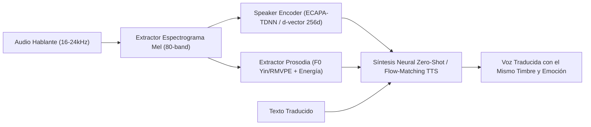

# 🎙️ Voice Cloning, Acoustic Embeddings & Real-Time Timbre Adaptation

## 1. Propósito y Alcance
Este skill codifica la ingeniería de **Clonación de Voz en Tiempo Real, Adaptación Continua de Timbre y Discreción Visual Operativa** para sistemas de traducción simultánea *Speech-to-Speech (S2S)*, doblaje en vivo y asistentes vocales personalizados.

---

## 2. Arquitectura de Clonación Acústica y Preservación Prosódica

### 2.1. Estudio de Pre-Calibración Vocal en 1 Clic (*Pre-Meeting Voice Calibration Studio*)
Para que el sistema suene con la voz natural del usuario **desde el primer segundo de una videollamada**:
1. Presentar un flujo guiado de **15 a 30 segundos** con un texto fonéticamente balanceado para leer en voz alta.
2. Extraer localmente el espectrograma Mel, los formantes vocálicos ($F_1, F_2, F_3$), el rango de frecuencia fundamental ($F_0$ medio, mínimo y máximo) y el vector de identidad vocal (*Speaker Embedding* normalizado en norma $L_2$).
3. Persistir el perfil acústico cifrado (`AES-256-GCM`) en el almacenamiento local de la estación de trabajo, con consentimiento explícito del titular.

### 2.2. Refinamiento Acústico en Caliente (*In-Flight Voice Mimicking*)
Durante una sesión en vivo donde no hubo pre-calibración (ej. interlocutores remotos):
1. **Arranque Instantáneo (0–3 s):** Seleccionar un perfil base según la estimación rápida de $F_0$ y timbre inicial.
2. **Adaptación Progresiva (3–15 s):** Acumular segmentos de voz limpia (filtrados por VAD `Silero` con `SNR > 15 dB`), actualizar el promedio móvil exponencial (EMA) del vector de incrustación $\mathbf{e}_t = \alpha \mathbf{e}_{t-1} + (1 - \alpha)\mathbf{e}_{\text{nuevo}}$ y transferir la cadencia, pausas respiratorias y entonación emocional al audio sintetizado.

---

## 3. Matriz Multilingüe Bidireccional Dinámica
- **Canales Independientes y Sin Bucle Acústico:**
  - **Canal Entrante (Loopback / Reunión):** Escucha en Idioma A (ej. Inglés `en`) ➔ sintetiza en Idioma B (ej. Español `es`) hacia los auriculares físicos del usuario.
  - **Canal Saliente (Micrófono Físico):** Captura en Idioma B (`es`) ➔ sintetiza en Idioma A (`en`) con el timbre clonado del usuario hacia el Micrófono Virtual de la videollamada.
- **Swap Instantáneo (`⇄`):** Intercambio en caliente del par lingüístico (`es`, `en`, `fr`, `de`, `it`, `pt`, `zh`, `ja`) sin reiniciar los flujos de audio ni cortar los sockets WebSocket.

---

## 4. Modo Barra Flotante Discreta (*Stealth Draggable & Resizable Pill Bar*)
1. **Movilidad y Redimensionamiento Dinámico:** Ventana sin bordes nativos (`frameless`), arrastrable con persistencia de coordenadas `(x, y)` multi-monitor y redimensionable entre **240px** (modo micro-pill con indicadores LED y vúmetros minimalistas) y **580px** (modo expandido con subtítulos en vivo).
2. **Exclusión de Captura de Pantalla:** Aplicar bandera nativa del sistema operativo (`SetWindowDisplayAffinity(hwnd, WDA_EXCLUDEFROMCAPTURE)` en Windows / propiedades de ventana overlay en Linux/macOS) y atajo global (`Ctrl + Shift + H`) para ocultar en el *System Tray* al compartir pantalla.

